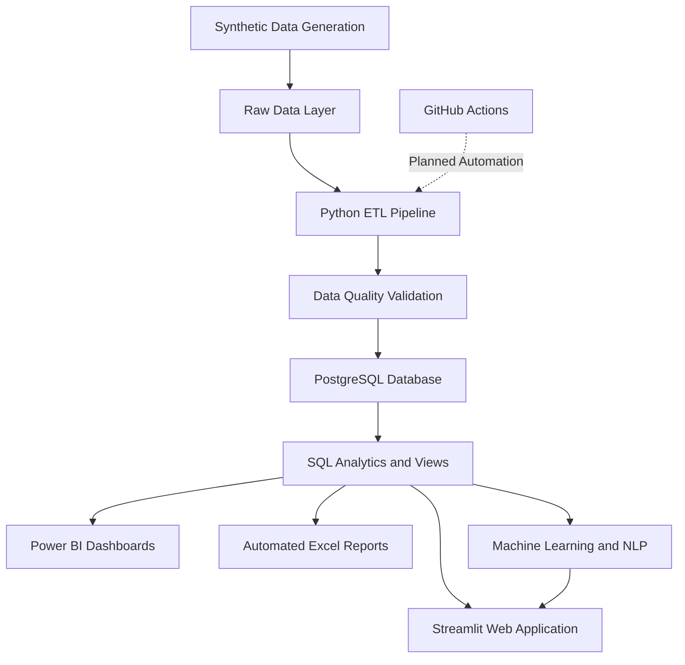

# StayPulse — Hotel Operations Intelligence Platform


## Project Overview

StayPulse is an end-to-end Hotel Operations Intelligence Platform designed to transform hotel operational data into actionable business insights through data engineering, business analytics, automation, business intelligence and machine learning.

The project simulates realistic multi-property hotel operations using synthetic data and aims to establish a centralized analytical platform for monitoring business performance, operational efficiency and guest experience.

## Business Problem

Hotel operations generate large volumes of data across booking platforms, inventory systems, payment systems, guest reviews and operational support channels.

Fragmented data sources and manual reporting can lead to:

- Inconsistent business performance reporting.
- Limited visibility into occupancy and revenue.
- Inventory discrepancies across multiple property listings.
- Delayed identification of operational issues.
- Inefficient manual reporting processes.
- Difficulty in identifying recurring guest complaints.

StayPulse aims to address these challenges through an integrated, data-driven analytical platform.

## Project Objectives

- Build a centralized relational database for hotel operations.
- Generate realistic and reproducible synthetic hotel data.
- Develop automated Python-based ETL pipelines.
- Monitor occupancy, revenue and booking performance.
- Analyze booking channels and cancellation trends.
- Evaluate guest experience and operational efficiency.
- Automate recurring Excel reports.
- Develop interactive Power BI dashboards.
- Implement sentiment analysis and anomaly detection.
- Build an interactive web-based analytics application.
- Implement automated testing, cloud deployment and CI/CD workflows.

## Planned Platform Modules

| Module | Description |
|---|---|
| Property Management | Physical properties, listings and organizational hierarchy |
| Booking Analytics | Reservations, booking channels and booking lifecycle |
| Inventory Intelligence | Contracted, sellable, booked and used room inventory |
| Revenue Analytics | Revenue, payments, refunds and financial KPIs |
| Guest Intelligence | Guest profiles, booking behavior and repeat guests |
| Review Analytics | Guest ratings, complaints and sentiment analysis |
| Operations Intelligence | Operational cases, root causes and SLA monitoring |
| Digital Check-in | Pre-check-in adoption and guest verification |
| Smart Lock Analytics | Access events, adoption and operational failures |
| Reporting Automation | Automated Excel reports and business summaries |
| Predictive Analytics | Anomaly detection and operational insights |

## Proposed System Architecture



## Technology Stack

| Layer | Technologies |
|---|---|
| Programming | Python |
| Data Processing | Pandas, NumPy |
| Synthetic Data | Faker |
| Database | PostgreSQL |
| Database Integration | SQLAlchemy, Psycopg |
| Data Analytics | SQL, Python |
| Business Intelligence | Power BI, DAX |
| Reporting | Microsoft Excel, OpenPyXL |
| Machine Learning | Scikit-learn — planned |
| Natural Language Processing | Sentiment analysis — planned |
| Web Application | Streamlit / Lovable — planned |
| Testing | Pytest, SQL validation |
| Version Control | Git, GitHub |
| Automation | GitHub Actions — planned |
| Deployment | Cloud infrastructure — planned |

## Key Business KPIs

| KPI | Description |
|---|---|
| CRN | Contracted Rooms |
| SRN | Sellable Rooms |
| BRN | Booked Rooms per Night |
| URN | Used Rooms per Night |
| Occupancy Rate | Used room nights relative to sellable room nights |
| ADR | Average Daily Rate |
| RevPAR | Revenue per Available Room |
| Cancellation Rate | Percentage of eligible bookings cancelled |
| No-Show Rate | Percentage of eligible bookings marked as no-show |
| Booking Channel Mix | Distribution of bookings across acquisition channels |
| Review Score | Average guest review rating |
| Review Conversion | Percentage of eligible stays generating reviews |
| SLA Compliance | Percentage of cases resolved within defined SLA |
| Digital Check-in Adoption | Percentage of eligible bookings completing digital check-in |
| Smart Lock Adoption | Percentage of eligible stays using smart lock access |

Detailed KPI definitions, eligibility criteria and calculation rules will be maintained in the project documentation.

## Database Design Principles

- Separate physical properties from individual property listings.
- Maintain shared inventory across multiple listings of the same physical property.
- Maintain fixed contracted room capacity at physical property level.
- Track SRN, BRN and URN on a daily basis.
- Assign a unique numeric booking ID to every booking.
- Maintain one unique alphanumeric invoice number per booking.
- Maintain separate payment and refund transactions.
- Enforce referential integrity and data quality constraints.

The initial database schema has been drafted and is awaiting implementation and validation.

## Repository Structure

```text
staypulse-hotel-operations-intelligence/
|
|-- .github/workflows/
|-- app/
|-- data/
|   |-- raw/
|   |-- processed/
|   |-- sample/
|-- docs/
|   |-- requirements/
|   |-- design/
|   |-- testing/
|   |-- DECISION_LOG.md
|-- notebooks/
|-- powerbi/
|-- reports/
|-- sql/
|   |-- schema/
|   |-- queries/
|   |-- views/
|-- src/
|   |-- analytics/
|   |-- data_generation/
|   |-- etl/
|-- tests/
|   |-- unit/
|   |-- integration/
|   |-- data_quality/
|   |-- sql/
|-- .env.example
|-- .gitignore
|-- CHANGELOG.md
|-- LICENSE
|-- README.md
|-- requirements.txt
```

## Getting Started

### Prerequisites

- Python 3.13
- Git
- PostgreSQL (required for upcoming database implementation)
- Visual Studio Code (recommended)

### Clone the Repository

```bash
git clone https://github.com/Kaveendersingh/staypulse-hotel-operations-intelligence.git
cd staypulse-hotel-operations-intelligence
```

### Create a Virtual Environment

```bash
python -m venv .venv
```

### Activate the Environment (Windows PowerShell)

```powershell
.\.venv\Scripts\Activate.ps1
```

### Install Dependencies

```bash
python -m pip install -r requirements.txt
```

### Verify Dependencies

```bash
python -m pip check
```

Database configuration and application execution instructions will be added after database implementation.

## Development Roadmap

- [x] Project planning and requirements documentation
- [x] Initial database design and schema draft
- [x] GitHub repository initialization
- [x] Local development environment setup
- [x] Python dependency installation and verification
- [ ] PostgreSQL database implementation
- [ ] Database schema validation
- [ ] Synthetic data generation
- [ ] Python ETL pipeline development
- [ ] SQL analytics and KPI development
- [ ] Power BI dashboards
- [ ] Excel reporting automation
- [ ] Sentiment analysis
- [ ] Anomaly detection
- [ ] Web application development
- [ ] Automated testing and CI/CD
- [ ] Cloud deployment

## Project Documentation

The project follows a structured Software Development Life Cycle (SDLC).

Documentation includes:

- Project Blueprint
- Business and Functional Requirements
- SDLC Implementation Roadmap
- Database Design and Data Specification
- Project Decision Log
- Change Log
- Testing Documentation

Refer to the `docs/` directory for detailed project documentation.

## Data Privacy and Disclaimer

StayPulse is an independent educational and portfolio project.

All hotel, guest, booking, financial and operational data used in the project will be synthetic. The project does not use confidential company information, real guest records or proprietary production datasets.

## Author

**Kaveender Singh**

Business Analytics | Data Analytics | Data Engineering | Business Intelligence

[GitHub Profile](https://github.com/Kaveendersingh)

## License

This project is licensed under the MIT License.

---

StayPulse — Transforming Hotel Operations into Actionable Intelligence.